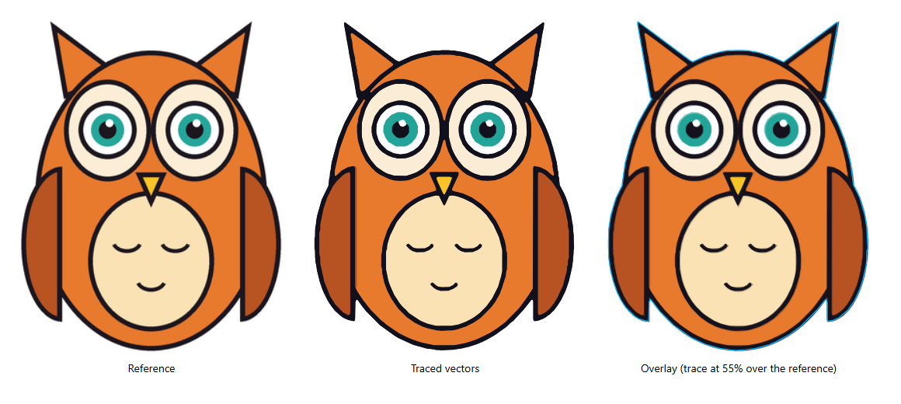

# image-to-vector

A [Claude Code](https://claude.com/claude-code) skill that turns a reference image into SVG that actually looks like it, then restyles it and, if you want, animates it.



*Left: the reference PNG. Middle: the traced SVG. Right: the SVG at 55% opacity over the reference, the check that proves they match.*

## Why

Ask an AI model to "draw this logo as SVG" and it types coordinates by eye. Each guess is a little off, the errors add up, and the result looks generic. This skill has Claude **trace the image's own pixels** instead. It then **proves the match** with an overlay and **gets your approval on previewed variants** before building anything into your project.

## What it does

1. **Samples the colours** of the reference and suggests a palette.
2. **Traces** each colour region into smooth SVG paths: nearest-colour classification, clean-up, marching squares on a lightly blurred mask, and simplification. The output is a flat-colour `trace.svg` plus `regions.json` with path data per layer.
3. **Proves the match** with a reference / rebuild / overlay page rendered to PNG.
4. **Restyles** into three variants (flat icon, soft 3D, cinematic metal) or recolours ("dark edition"), previewed at real sizes on dark and light backgrounds.
5. **Animates** (optional): idle, thinking, talking with lip-sync to a loudness envelope, paused.
6. **Builds it in** as a generated code module (`shapes.ts`) rather than pasted path strings.

Works best on flat artwork: logos, icons, cartoons, mascots, "how to draw" final steps. Photos and 3D renders trace poorly; the skill asks for a flat drawing instead.

## Install

As a plugin, from Claude Code:

```
/plugin marketplace add SimsonCorreya/skills
/plugin install image-to-vector@skills
```

Or copy the folder into your skills directory:

```bash
git clone https://github.com/SimsonCorreya/skills.git
cp -r skills/image-to-vector ~/.claude/skills/              # every project
cp -r skills/image-to-vector <project>/.claude/skills/      # or one project
```

Requirements:

- Python 3.9+ with Pillow, NumPy and scikit-image: `pip install pillow numpy scikit-image` (or `pip install -r requirements.txt` from this folder)
- Node 18+
- Microsoft Edge, Google Chrome or Chromium, for rendering previews (or set `CHROME_PATH`)

Then just ask Claude, for example: *"Make an SVG of this logo"*, *"Turn my mascot drawing into a vector icon with a dark edition"*, or *"My SVG doesn't look like the reference, fix it"*.

## Try the scripts directly

The skill bundles an original example (an owl mascot) you can run end to end:

```bash
cd image-to-vector
python -I scripts/palette.py examples/owl/owl.png
python -I scripts/trace.py examples/owl/owl.png examples/owl/owl.config.json out
node scripts/compare.mjs out/regions.json examples/owl/owl.png examples/owl/owl.config.json out/compare.html
python -I scripts/render.py out/compare.html out/compare.png --size 1160x520
node scripts/emit_shapes.mjs out/regions.json out/shapes.ts --name OWL --layers silhouette,body,wings=wing[],eyes=eye,ink
```

| Script | Does |
| --- | --- |
| `scripts/palette.py` | Dominant colours, subject box, starter palette |
| `scripts/trace.py` | Image + config → `regions.json`, `trace.svg`, `classes.png` |
| `scripts/compare.mjs` | Reference / rebuild / overlay comparison page |
| `scripts/render.py` | Headless-browser screenshot of any HTML or SVG page |
| `scripts/emit_shapes.mjs` | `regions.json` → a TS/JS module of path data and a `viewBox` |

## Layout

```
image-to-vector/
├── SKILL.md                    the workflow Claude follows
├── scripts/                    the tools above
├── references/
│   ├── config.md               every trace-config key, with fixes for common problems
│   ├── styles.md               flat / soft 3D / cinematic metal recipes, palette swaps
│   ├── animation.md            moods, CSS vs SMIL, lip-sync, size limits, embedding
│   └── claude-code-mods.md     notes for putting the art in a Claude Code mod
└── examples/owl/               an original example image, its config, and the results
```

## A note on trademarks

Tracing a logo or a character for personal use is fine. Publishing or selling a traced trademark is a different matter. The bundled example is original artwork, drawn by `examples/owl/draw_owl.py`.

## License

MIT
